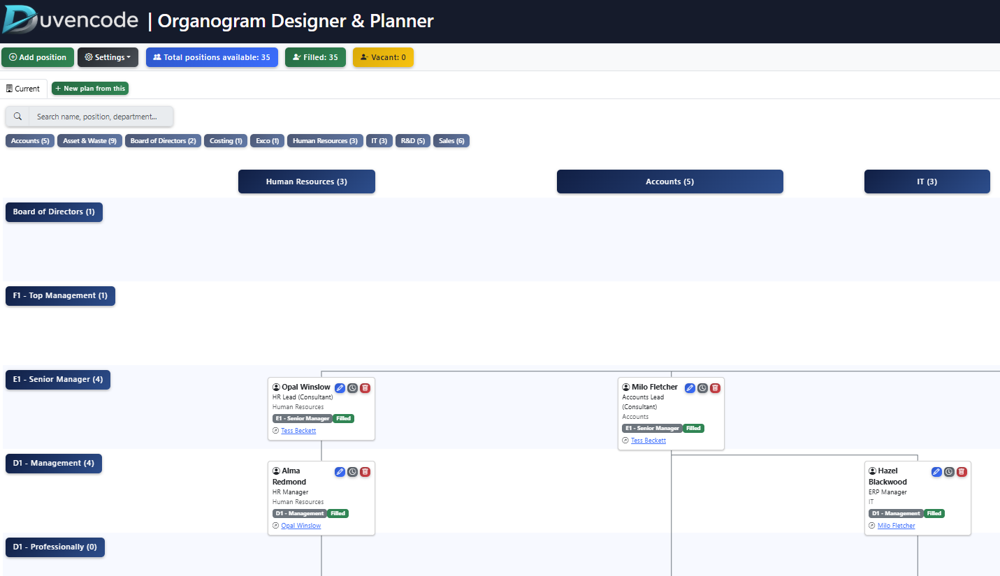

# Organogram App

Organogram Designer & Planner: a Blazor Server web app (.NET 10) for building and maintaining an organisation chart.



## Features

- Add, edit and delete positions (name, position/function, department, job grade, status, reports-to)
- Interactive organogram with draggable cards
- Manage departments and job grades (add, rename, delete, custom ordering)
- Multiple named plans, so you can model alternative structures
- Change history log for every edit
- Export the organogram to PDF or Excel, and the history to Excel

## Requirements

- [.NET 10 SDK](https://dotnet.microsoft.com/download)

## Getting started

```powershell
git clone https://github.com/duvenco/organogram-app.git
cd organogram-app
dotnet run
```

Then open the URL shown in the console. When running a published build (non-Development), the app opens your default browser automatically; set `"OpenBrowser": false` in `appsettings.json` to disable this.

## Data storage

Data is stored as JSON files in the app's content root:

| File | Purpose |
|------|---------|
| `EmployeeData.json` | Positions and reporting lines |
| `OrganogramMeta.json` | Extra departments, grades and grade order |
| `EmployeeHistory.json` | Change history |

Additional plans are stored in a `Plans\<plan name>\` folder containing the same three files.

## Project structure

- `Components/` – Razor components, layout and pages (main UI in `Pages/Home.razor`)
- `Models/` – `Employee` and `HistoryEntry` models
- `Services/EmployeeService.cs` – data access, plans and change tracking
- `wwwroot/` – static assets

## Publishing

```powershell
dotnet publish -c Release -o publish
```

Keep the JSON data files next to the published executable.

## License

See [LICENSE.txt](LICENSE.txt).
